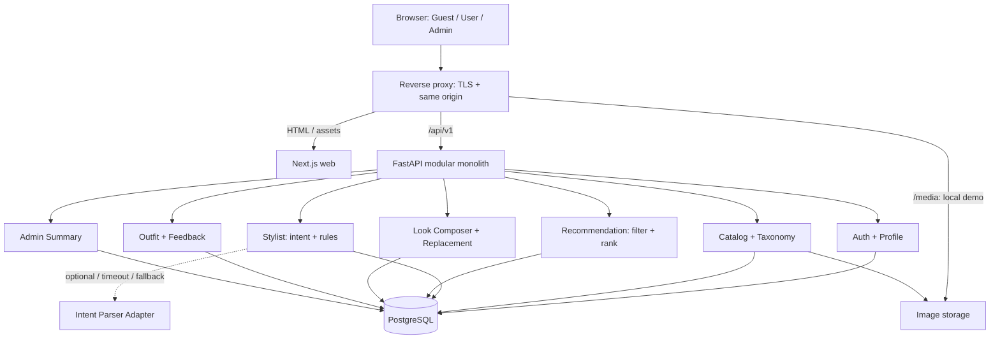
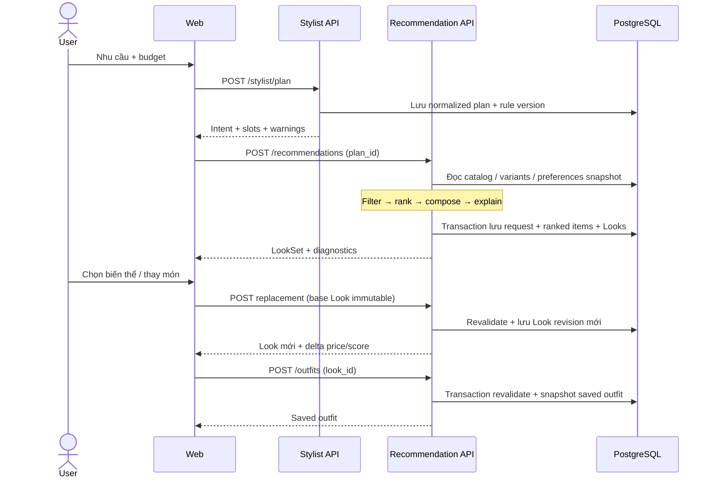

# 01 — Kiến trúc hệ thống

## 1. Mục tiêu và ranh giới

MVP phục vụ người dùng tìm outfit theo dịp, phong cách, màu và tổng ngân sách. Catalog tối thiểu 1.000 sản phẩm sạch có ảnh; mục tiêu demo 2.000–5.000. Khuyến nghị phải truy được về sản phẩm thật, có score và lý do; không sinh tên sản phẩm bằng LLM.

Guest xem Home, teaser Looks, đăng ký/đăng nhập. USER dùng catalog, profile, stylist, lịch sử, saved Looks và feedback. ADMIN có thêm quản trị catalog, variants, taxonomy, rules và counters. Quyền truy cập dữ liệu cá nhân luôn kiểm tra ở backend.

Phase 1 không có thanh toán, checkout thương mại, đơn hàng, giao vận, học mô hình, vector search hoặc Virtual Try-On. UI dùng collage ảnh các món thật, không ngụ ý người mẫu đang mặc chính xác các món nếu chưa có ảnh được xác minh.

## 2. Kiến trúc triển khai



Một backend process triển khai cùng một database, nhiều module nghiệp vụ. Module trên hình là boundary trong code, không phải microservice. Có thể chạy nhiều API worker sau khi đo tải. Không cần Redis, Kafka, Celery, Kubernetes hoặc GPU trong MVP này.

| Thành phần | Quyết định | Trách nhiệm |
|---|---|---|
| Web | Next.js App Router + TypeScript | Home/editorial, protected app, admin, tương tác Look |
| UI | Tailwind CSS, tokens, component chung | Responsive, accessibility, motion có mục đích |
| State/form | TanStack Query; React Hook Form + Zod | Server cache, mutation, form validation |
| API | FastAPI + Pydantic | REST, auth, schema, OpenAPI |
| Persistence | PostgreSQL + SQLAlchemy + Alembic | Query, transaction, schema evolution |
| Auth | Argon2id; JWT access + opaque refresh session | Phiên đăng nhập có thể thu hồi |
| Storage | Local volume demo; S3-compatible khi deploy cần | Product images, thumbnails, import artifacts |
| Dev/release | Docker Compose; CI trên GitHub hoặc GitLab | Môi trường tái tạo, lint/test/build |

Version cụ thể sẽ khóa ở bước scaffold bằng lockfile và image digest sau khi kiểm tra tương thích; đây chưa phải dependency manifest có thể chạy.

## 3. Dependency và module

`router → application service → domain policy / repository interface → SQLAlchemy adapter`.

DTO API dùng Pydantic, entity persistence dùng SQLAlchemy; không trả ORM object trực tiếp thành public contract. Service sở hữu transaction; repository không tự commit. Dùng session theo request, không singleton session. Bắt đầu với SQLAlchemy đồng bộ + psycopg và route đồng bộ cho DB workload; không gọi DB blocking bên trong async handler. Parser async tùy chọn cần adapter hoặc thread boundary rõ ràng.

| Module | Sở hữu | Giao tiếp |
|---|---|---|
| auth | users, auth_sessions, credentials/RBAC | CurrentUser dependency |
| profiles | profiles, preferences, preference joins | PreferenceReader |
| catalog | products, variants, images, taxonomy, imports | ProductRepository, TaxonomyReader |
| stylist | normalized intent, rules, plans | IntentParser, RuleProvider; không đọc sản phẩm |
| recommendations | requests, ranked items, score/reasons/version | ProductRepository, PreferenceReader, Ranker |
| looks | complete generated Looks, alternatives, revisions | LookComposer, catalog availability reader |
| outfits | saved Looks, favorite, duplicate | Ownership + catalog revalidation |
| feedback | like/dislike theo target và context | TargetAccessPolicy |
| admin | counters và audit | Read-only aggregate services; mutation qua module sở hữu |

Controller không viết SQL/ranking. Frontend không chứa rule chọn outfit hoặc quyết định giá/tổng hợp lệ. Cross-module gọi service/interface công khai, không import router hoặc sửa bảng module khác tùy tiện. Không tạo generic base repository quá sớm.

Các interface cần giữ ổn định:

```text
IntentParser.parse(text, locale) -> ParsedIntent
StylistService.plan(context) -> OutfitTemplate
ProductRepository.find_candidates(slot, constraints) -> Candidate[]
RecommendationService.rank(candidates, context) -> RankedItem[]
LookComposer.compose(template, ranked_by_slot, budget) -> LookSet
ReplacementService.preview(look, slot, constraints) -> Alternative[]
ImageStorage.put/read/delete(object_key) -> AssetReference
```

## 4. Cấu trúc repository dự kiến

Đây là cây sẽ tạo khi triển khai; hiện tại repository chỉ có bộ thiết kế. Không đặt file rỗng giả làm ứng dụng đã chạy.

```text
fashion-ai/
├── apps/
│   ├── web/
│   │   ├── src/app/
│   │   │   ├── (public)/                 # Home, login, register, teaser Looks
│   │   │   ├── (user)/                   # shop, stylist, recommendations, my-looks, profile
│   │   │   └── admin/                    # layout quyền ADMIN + các trang quản trị
│   │   ├── src/features/
│   │   │   ├── auth/ profile/ catalog/ stylist/
│   │   │   ├── recommendations/ interactive-look/ outfits/ feedback/ admin/
│   │   ├── src/components/               # UI primitives và layout chung
│   │   ├── src/lib/                      # API transport, query client, formatters
│   │   ├── src/styles/                   # design tokens, globals
│   │   ├── public/                       # brand assets; không chứa uploads
│   │   └── tests/                        # component và Playwright
│   └── api/
│       ├── app/main.py                   # bootstrap; không chứa nghiệp vụ
│       ├── app/core/                     # config, errors, security, logging
│       ├── app/db/                       # engine, session, metadata, unit of work
│       ├── app/modules/
│       │   ├── auth/ profiles/ catalog/ stylist/
│       │   ├── recommendations/ looks/ outfits/ feedback/ admin/
│       │   └── mỗi module:
│       │       ├── router.py             # request/response, dependency
│       │       ├── schemas.py            # API DTO
│       │       ├── service.py            # use case / transaction
│       │       ├── policies.py           # policy thuần khi cần
│       │       ├── ports.py              # interface khi thực sự có boundary
│       │       ├── repository.py         # SQLAlchemy adapter
│       │       └── models.py             # persistence model
│       ├── app/adapters/                 # storage, optional LLM parser
│       ├── migrations/versions/          # Alembic revisions
│       ├── scripts/                      # CLI import, seed, create-admin
│       └── tests/unit/ integration/ api/
├── packages/api-client/                  # TypeScript generated từ OpenAPI; không sửa tay
├── contracts/                            # exported OpenAPI, example fixtures
├── data/
│   ├── taxonomy/                         # category/color/style/occasion mappings
│   ├── rules/                            # versioned seed rules
│   ├── raw/ cleaned/                     # dữ liệu local, không commit bulk mặc định
│   └── reports/                          # QA report, license/source manifest
├── infra/                                # Dockerfiles, proxy, compose, env example
├── scripts/                              # dev bootstrap, verify, backup/restore
├── docs/design/                          # bộ thiết kế hiện tại
├── docs/runbooks/                        # deploy, restore, demo khi đã kiểm chứng
└── .github/workflows/                    # nếu chọn GitHub
```

## 5. Luồng chính và transaction



Plan có owner; recommendation chỉ nhận plan thuộc user hiện tại. Khi generate, chụp context/preferences và rule version để replay; sau đó thay profile không thay kết quả lịch sử. Read catalog có thể cũ sau response: replace/save luôn kiểm tra lại giá, availability và ngân sách trong transaction.

Không giữ transaction DB mở trong lúc gọi LLM. Tạo recommendation bằng một request đồng bộ; UI thể hiện giai đoạn plan thành công rồi giai đoạn đang tìm/ghép đang chờ. Không dựng giả tiến độ bằng timer. Nếu sau này cần job dài, thêm job adapter mà giữ Look response schema.

## 6. Điểm nối Phase 2

Thay Ranker bằng hybrid/FashionCLIP qua cùng interface, thêm embedding table và pipeline riêng bằng migration. IntentParser có thể thay provider nhưng output phải qua schema/taxonomy. `visual.kind` có thể mở rộng từ COLLAGE/CURATED_IMAGE thành TRY_ON cùng hotspots/item mapping. Chưa tạo bảng vector/user photos/try-on jobs trong Phase 1. Score luôn đi cùng version để không so sánh tùy tiện giữa các model.

## 7. Cơ sở kỹ thuật

FastAPI hỗ trợ chia router theo module: [Bigger Applications](https://fastapi.tiangolo.com/tutorial/bigger-applications/). Thiết kế frontend phân biệt vùng render server và vùng tương tác theo [Next.js Server and Client Components](https://nextjs.org/docs/app/getting-started/server-and-client-components). Ranh giới commit/rollback ở service dựa trên [SQLAlchemy transaction management](https://docs.sqlalchemy.org/en/20/orm/session_transaction.html). Các lựa chọn domain ở trên là đề xuất cho dự án này.
