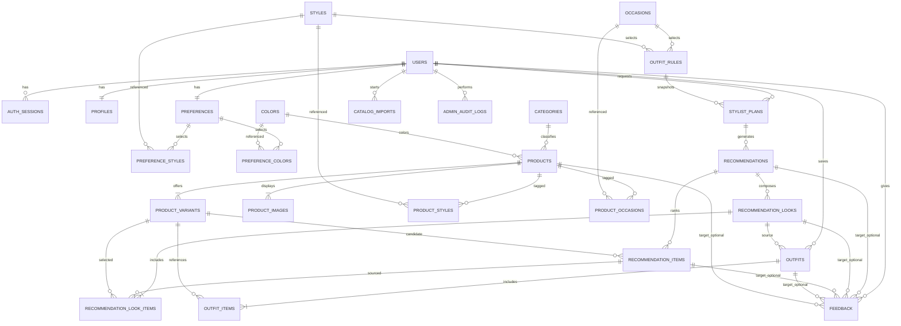

# 02 — Dữ liệu và ERD

## 1. Quy ước

PostgreSQL là nguồn dữ liệu chính. PK dùng UUID; thời điểm dùng `timestamptz` UTC, giao diện format theo locale. Giá dùng `bigint` số nguyên VND, không dùng float; chỉ hỗ trợ VND trong Phase 1. Score lưu `numeric(8,6)` trong [0,1]; rank bắt đầu từ 1. Mã taxonomy là chuỗi viết hoa ổn định, label là nội dung hiển thị có thể dịch.

Các bảng nghiệp vụ có `created_at`; bảng sửa được có `updated_at`. Owner là `user_id` lấy từ phiên xác thực, không lấy từ body. API phát ID dưới dạng string; không dựa vào UUID để thay kiểm tra quyền.

## 2. ERD logic

Feedback có đúng **một** target trong năm FK trên, không phải đồng thời cả năm. Generated Look thuộc recommendation là draft bất biến; saved outfit là bản được người dùng lưu. UI gọi cả hai là Look, persistence dùng tên khác để tránh nhầm vòng đời.

## 3. Data dictionary

| Bảng | Cột chính ngoài timestamps | Ràng buộc / hành vi |
|---|---|---|
| users | id, email, password_hash, role, status | unique index `lower(email)`; role USER/ADMIN; status ACTIVE/DISABLED; register luôn USER |
| auth_sessions | id, user_id, refresh_token_hash, family_id, expires_at, revoked_at, replaced_by_id | refresh token unique hash; rotation và reuse detection; không lưu token thô |
| profiles | user_id PK/FK, display_name, gender nullable, age_range nullable, locale | gender MALE/FEMALE/UNISEX hoặc null; không bắt buộc tuổi |
| preferences | user_id PK/FK, budget_min_vnd nullable, budget_max_vnd nullable | cả hai không âm, min ≤ max khi cùng có; explicit request được override |
| preference_styles | user_id, style_code | composite PK, FK preferences/styles |
| preference_colors | user_id, color_code | composite PK, FK preferences/colors |
| categories | code PK, parent_code nullable FK, label, item_role, active | cây không cycle qua service; role TOP/BOTTOM/OUTERWEAR/SHOES; category leaf được dùng cho product |
| colors | code PK, label, hex nullable, family, active | family phục vụ NEUTRAL/WARM/COOL; không dùng label để matching |
| styles | code PK, label, active | disable khi đang được dùng, không hard delete |
| occasions | code PK, label, active | tương tự styles |
| products | id, product_code, name, brand nullable, category_code, gender, color_code, base_price_vnd, description, active, source, price_source | product_code unique; một product là một thiết kế + màu; đổi màu tạo product khác |
| product_variants | id, product_id, sku, size_code, price_override_vnd nullable, available, active | sku unique, unique(product_id,size_code); effective_price = override hoặc base; `ONE_SIZE` khi thiếu size |
| product_images | id, product_id, storage_key, alt_text, sort_order, is_primary, source_url nullable, attribution nullable | unique primary per product bằng partial index; storage_key duy nhất; primary image bắt buộc khi publish |
| product_styles | product_id, style_code | composite PK; cho phép thiếu tag, không crash ranking |
| product_occasions | product_id, occasion_code | composite PK; tương tự style |
| outfit_rules | id, rule_key, version, occasion_code, style_code nullable, gender nullable, slots JSONB, priority, active | unique(rule_key,version); sửa rule tạo version; publish kiểm tra schema và coverage |
| stylist_plans | id, user_id, raw_text nullable, normalized_context JSONB, template JSONB, rule_id, parser_version, schema_version, expires_at | snapshot rule/context; plan hết hạn sau 24h theo cấu hình |
| recommendations | id, user_id, plan_id, context_snapshot JSONB, algorithm_version, catalog_version, rule_version, status, diagnostics JSONB, result_snapshot JSONB, duration_ms | status COMPLETE/PARTIAL/NO_RESULTS; request/result gốc bất biến |
| recommendation_items | id, recommendation_id, slot_key, product_id, variant_id, rank, score, score_components JSONB, reasons JSONB, product_snapshot JSONB | unique(recommendation_id,slot_key,product_id); rank unique theo slot; một variant đại diện khả dụng mỗi product |
| recommendation_looks | id, recommendation_id, label, name, total_price_vnd, score, budget_limit_vnd, visual JSONB, reasons JSONB, source_look_id nullable, revision | Look bất biến; generated ban đầu revision 1; replacement tạo row mới, không sửa Look cũ |
| recommendation_look_items | id, look_id, slot_key, item_role, product_id, variant_id, recommendation_item_id nullable, score, reasons JSONB, snapshot JSONB | unique(look_id,slot_key); recommendation_item_id nullable cho replacement ngoài original Top-K |
| outfits | id, user_id, source_look_id nullable, name, occasion_code, style_code nullable, context_snapshot JSONB, total_price_vnd, score, is_favorite, version, deleted_at nullable | saved snapshot, user tự đổi tên/favorite; source nullable khi duplicate hoặc dữ liệu nguồn được xóa theo retention |
| outfit_items | id, outfit_id, slot_key, item_role, product_id, variant_id, price_snapshot_vnd, product_snapshot JSONB | unique(outfit_id,slot_key); giữ ảnh/tên/giá/score snapshot lúc lưu |
| feedback | id, user_id, recommendation_id nullable, recommendation_item_id nullable, look_id nullable, outfit_id nullable, product_id nullable, value, reason_code nullable, context JSONB | value LIKE/DISLIKE; đúng một target; unique(user_id,target) qua partial unique index cho từng target |
| catalog_imports | id, user_id, file_key, checksum, mapping_version, status, counts JSONB, report_key nullable, catalog_version nullable | trạng thái VALIDATED/IMPORTED/FAILED; báo cáo lỗi theo row; import không công khai |
| admin_audit_logs | id, actor_id, action, entity_type, entity_id, request_id, changes JSONB | append-only, không chứa credentials hoặc raw secret |
| idempotency_requests | id, user_id, scope, key, request_hash, status, response_resource_id nullable, expires_at | bảng kỹ thuật; unique(user_id,scope,key); TTL 24h; resource cùng transaction với COMPLETE |

`stock` trong blueprint được biểu diễn bằng `available` ở variant. Product còn hàng khi active và có ít nhất một active/available variant. Không quản lý số lượng tồn kho hoặc reserve stock vì không checkout.

Snapshot item gồm `product_code`, tên, brand, category, color, variant/size, effective price, image storage key, score và reasons tại thời điểm tạo. Không nhúng binary ảnh. Ảnh đã được snapshot không xóa vật lý khi product bị deactivate; có thể chuyển sang placeholder nếu nguồn ảnh ngoài mất, không làm hỏng lịch sử.

`idempotency_requests` là bảng kỹ thuật ngoài ERD nghiệp vụ, FK user_id → users; response_resource_id là reference theo scope đã allowlist, không generic FK tùy ý do client gửi. Mọi variant effective price phải không âm kể cả override. Constraints score/rank áp dụng cho cả ranked items, generated Looks và saved snapshots.

`visual` gồm kind, image reference nếu có, aspect ratio và hotspots theo slot. COLLAGE dùng ảnh thật của look_items và layout preset, không cần AI image generation. Thông tin vị trí normalized [0,1] được xác định theo layout collage, không tự đoán vị trí quần áo trên model.

## 4. Integrity và transaction

- Mọi price/check ngân sách: nonnegative, tổng server tính từ effective variant prices. Không tin giá hoặc score client gửi.
- `CHECK num_nonnulls(recommendation_id,recommendation_item_id,look_id,outfit_id,product_id)=1` cho feedback; service kiểm tra owner của target cá nhân. Product target chỉ cần product tồn tại/truy cập được.
- Variant phải thuộc đúng product: composite unique `(id,product_id)` ở product_variants và composite FK `(variant_id,product_id)` từ các bảng item; không chỉ kiểm tra bằng UI.
- Cross-row invariants như slot thuộc template, tổng giá, owner/source cùng user được service bảo vệ trong transaction; không mô tả chúng như CHECK liên bảng.
- Save/replacement khóa product và variant đã chọn theo thứ tự ID ổn định, đọc lại active/price/available rồi commit. Admin update dùng cùng row locking discipline. Không giữ lock trong lúc render hoặc gọi mạng ngoài.
- Product được deactivate, không hard-delete khi có lịch sử. Taxonomy đang được tham chiếu không xóa. Soft delete outfit không xóa feedback/snapshot ngay.
- Refresh rotation khóa session row; token cũ chỉ được dùng một lần. Create user + profile + preferences là một transaction.
- Import: validate toàn file trước; transaction upsert catalog theo external code/SKU. Không bật mặc định reset data; chạy lại cùng dữ liệu không tăng duplicate.
- Replacement tạo look_id mới, source_look_id trỏ bản đang xem, revision = source.revision + 1. Có thể rẽ nhánh từ cùng base; không dựa riêng vào revision để định danh hoặc giả định lịch sử tuyến tính.

## 5. Index và query

| Query | Index ban đầu |
|---|---|
| Auth | unique lower(email), auth_sessions(user_id), unique refresh_token_hash |
| Candidate | products(category_code,gender,color_code) WHERE active; product_variants(product_id,available) WHERE active |
| Tags | product_styles(style_code,product_id), product_occasions(occasion_code,product_id) |
| Filter giá | products(base_price_vnd); price override join phải đo EXPLAIN với dataset thật |
| Tìm keyword | MVP ILIKE name/product_code/brand, giới hạn keyword và phân trang; chỉ thêm pg_trgm nếu EXPLAIN/tải thật cho thấy cần |
| Lịch sử | recommendations(user_id,created_at DESC,id), outfits(user_id,created_at DESC,id) WHERE deleted_at IS NULL |
| Detail | recommendation_items(recommendation_id,slot_key,rank), recommendation_looks(recommendation_id), outfit_items(outfit_id) |
| Feedback/counters | target partial unique indexes; feedback(created_at,value), outfits(created_at), products(active) khi query plan cần |

Filter giá và availability dùng effective variants, không lọc sai bằng base price đơn thuần. Không thêm hàng loạt index JSONB trước khi có query cụ thể. Catalog paging sort luôn có tie-break ID; count và rows có thể chênh khi catalog đang cập nhật, chấp nhận cho browse.

## 6. Catalog pipeline và taxonomy

`raw + source/license manifest → normalize → dedupe → image check → enrich tags → validate → cleaned CSV/JSON → dry-run → transactional upsert → QA report`.

- Giữ product_code từ nguồn, hoặc prefix theo nguồn; SKU phải ổn định. Phân biệt missing và unmapped, không âm thầm biến tất cả thành UNKNOWN.
- File import gồm product fields + variant/size + image path/URL + style/occasion codes. CSV nhiều dòng cùng product_code cho nhiều variants phải có metadata chung nhất quán.
- Ảnh được kiểm tra ở pipeline (file tồn tại, decode, mime, kích thước); runtime API không tự fetch arbitrary URL để tránh SSRF. Chỉ nhập remote image từ host allowlist qua pipeline giới hạn timeout/size.
- `price_source=REAL|DEMO`, currency VND; catalog demo dùng giá giả phải có nhãn trên trang/chi tiết sản phẩm, không giả làm báo giá thương mại.
- Dataset không có size: tạo variant ONE_SIZE và hiển thị “Thông tin size chưa có”; không tự phát minh size S/M/L.
- Report: raw count, removed duplicates, missing images, invalid taxonomy, valid products/variants, tag coverage, coverage per required slot, ngân sách test có outfit khả thi, license/attribution.
- Acceptance: ≥1.000 active products hợp lệ có primary image; 0 duplicate code/SKU; đủ coverage cho bộ rule/demo. Dataset lớn nhưng thiếu SHOES vẫn không đủ cho complete Looks.

Taxonomy và rule ban đầu được mô tả trong [04](04-recommendation.md). Seed versioned trong repo; admin thay đổi tạo audit và tăng catalog/rule version. Deployment chỉ seed taxonomy nếu chưa tồn tại, không ghi đè tùy tiện cấu hình admin.

## 7. Migration, backup và vòng đời

Migrations chia nhóm: identity → taxonomy/catalog → plans/ranking/generated Looks → outfits/feedback → imports/audit/indexes. Mỗi revision có upgrade và kiểm tra trên database sạch; production ưu tiên thay đổi additive, backfill rồi siết constraint. Seed là CLI riêng sau migration, không nhét dataset vào schema migration.

Đề xuất retention để triển khai ban đầu: plan chưa dùng 24h; raw import file 7 ngày; prompt thô 30 ngày rồi xóa, giữ normalized context đã giảm dữ liệu; recommendation/feedback và saved Looks giữ đến khi user yêu cầu xóa hoặc chính sách được chốt. Không đặt TTL 30 ngày cho kết quả đang được saved outfit tham chiếu. Yêu cầu xóa tài khoản phải purge/anonymize dữ liệu cá nhân theo quy trình riêng, không chỉ đổi users.status.

Backup database và ảnh phải đồng bộ về thời điểm hoặc có manifest key; backup DB đơn thuần không khôi phục được ảnh local. Runbook restore cần kiểm chứng trước phát hành.
