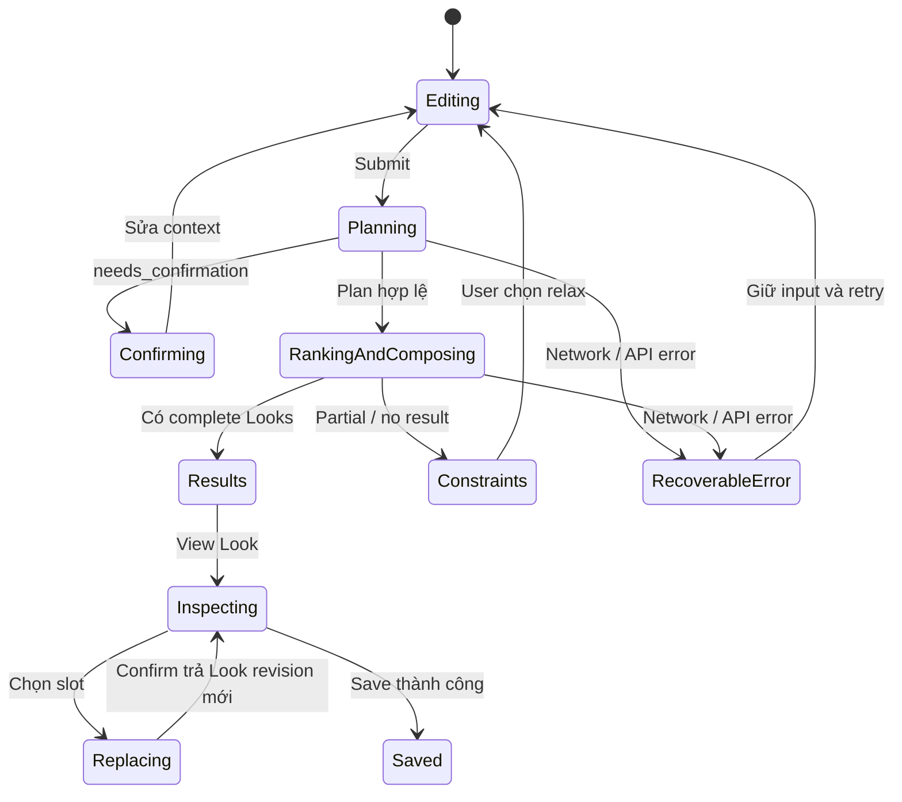

# 05 — Frontend và UI/UX

## 1. Hướng trải nghiệm

Theo UI/UX spec: fashion editorial, ảnh lớn, nhiều khoảng trắng, AI Stylist là hành động trung tâm. Người dùng nhận **Look hoàn chỉnh**, sản phẩm là thành phần trong Look. Admin dùng cùng tokens nhưng bố cục ưu tiên thao tác và thông tin.

Ngôn ngữ mặc định đề xuất tiếng Việt, format `vi-VN`, VND; label nội bộ codes không lộ thành UI. STYLEAI là tên tạm. Header desktop: Shop, Looks, AI Stylist; utilities Search, Favorites, Profile. Guest bấm Shop/Stylist chuyển login và giữ returnTo nội bộ đã allowlist, không chấp nhận redirect URL ngoài.

## 2. Design tokens

| Token | Giá trị |
|---|---|
| background / surface | #F5F4F0 / #FFFFFF |
| text / secondary | #111111 / #777777 |
| border / ai-accent | #E4E2DD / #D9FF43 |
| display font | Instrument Serif hoặc Playfair Display; fallback Georgia |
| UI font | Inter hoặc Manrope; fallback system-ui |
| spacing | 4,8,12,16,24,32,48,64,96px |
| radius | card 8–12; drawer/modal 16–20; button/pill 999px |
| content | tối đa 1280–1440px; 12 cột desktop, 4 cột mobile |
| motion | transition 150–250ms; image hover scale 1.03–1.05 |

Secondary #777 trên nền #F5F4F0 cần kiểm tra contrast trước dùng cho body nhỏ; chọn token đậm hơn nếu không đạt AA. Accent dùng chữ tối, không chữ trắng. Focus ring phải nhìn thấy cả trên ảnh. Self-host font khi license cho phép để demo không phụ thuộc mạng ngoài.

## 3. Route và quyền

| Route | Màn hình | Quyền / dữ liệu |
|---|---|---|
| / | Home | public; hero, curated teasers, How it Works, Start Styling |
| /login, /register | Auth | public; field errors, pending state, returnTo |
| /looks | Curated Looks teaser | public; nội dung duyệt, không lộ Look cá nhân |
| /shop | Catalog | User/Admin; filters nằm trong URL, pagination |
| /shop/[productId] | Product detail | User/Admin; gallery, variants, metadata |
| /stylist | Input và processing | User/Admin; text, chips, budget, editable defaults |
| /recommendations/[id] | Recommended Looks | Owner; BEST_MATCH / ALTERNATIVE / BUDGET_CHOICE |
| /recommendations/[id]/looks/[lookId] | Interactive Look | Owner; image/hotspots + items, replace, reasons, save |
| /history | Recommendation History | Owner; request summary, reopen |
| /my-looks | Personal lookbook | Owner; 2–4 cột, favorite/filter/delete/duplicate |
| /my-looks/[id] | Saved Look | Owner; snapshot + current availability hints |
| /profile | Preferences | Owner; visual chips/swatches, budget, gender optional |
| /admin | Summary | Admin |
| /admin/products | CRUD/import | Admin |
| /admin/products/[id]/variants | Variants | Admin |
| /admin/rules | Rule management | Admin; publish/version/coverage |
| /admin/taxonomy | Taxonomy | Admin; active/deactivate, mapping |

Route guards hỗ trợ UX; backend vẫn kiểm tra role/owner cho từng request. Server render vùng public/layout; client components cho form, query/mutation, hotspot/drawer. Không cache SSR dữ liệu cá nhân sang user khác. Không bắt buộc SSR protected queries ở MVP; có thể hydrate sau auth check mà không forward cookie sai origin.

## 4. Component và trách nhiệm

| Component | Trách nhiệm |
|---|---|
| Navigation, MobileMenu | sticky header, focus, mobile AI shortcut |
| AIStylistInput | text input, draft, submit; không tự quyết rule |
| StyleSelector, OccasionSelector, ColorSelector | code + localized labels, multi/single selection |
| BudgetSlider | numeric input đồng bộ, accessible min/max; số tiền là integer |
| ProcessingSteps | stage từ request lifecycle, skeleton, retry |
| LookCard, LookCarousel | label, visual, score, total, primary View Look |
| InteractiveLook, LookHotspot | visual-to-item selection theo slot_key |
| ProductMiniCard, VariantSelector | product/variant, availability, selection |
| ProductDrawer | chi tiết/reasons trong ngữ cảnh Look |
| ReplaceItemModal | alternatives, delta price/score, confirm |
| MatchScore, WhyRecommended | giải thích theo reason code và facts |
| CompleteLook | tổng giá, budget status, Save Full Look |
| FeedbackPanel | Like/Dislike, optional reason, pending/rollback |
| SavedLookCard | open/favorite/delete/duplicate |
| AdminProductForm, ImportReport | admin validation, image upload, dry-run/commit |

Feature components dùng generated API types; shared primitives chỉ biết presentation. Không đưa rule/category combinations hoặc ranking vào React hooks.

## 5. State và tương tác

Server state dùng TanStack Query với key có current user identity và resource ID. Local state gồm selected_slot_key, drawer, replace modal, text draft, form context. URL lưu filters/paging/shareable route, không lưu JWT/email/raw prompt. Không dùng global store cho mọi state.

State machine:

Processing hiển thị “Đang hiểu nhu cầu” trong POST plan; chỉ đánh dấu occasion/style/budget đã nhận sau response. POST recommendations hiển thị “Đang tìm và ghép Look” ở trạng thái pending; không đánh dấu riêng “đã tìm sản phẩm” khi backend chưa báo. Không thêm sleep để ép animation đủ lâu.

Interactive Look desktop chia 60/40. Left là collage ảnh đúng sản phẩm; hotspot là button có aria-label, focus và target ≥44px. Click/focus hotspot chọn product panel; chọn row focus/highlight hotspot cùng slot_key. Không phụ thuộc hover. Alt text nêu sản phẩm, không dùng filename. COLLAGE layout normalized tạo đúng mapping khi resize; nếu dùng curated model image phải có mapping được kiểm chứng, không gắn hotspot bừa.

Drawer desktop side panel, mobile bottom sheet, focus trap, Escape đóng, restore focus về trigger, background inert. Product Details không đưa user rời Look. Replace modal giữ bản cũ đến khi confirm server thành công, báo delta trước; server conflict giữ các lựa chọn, cho retry. Save chỉ enabled khi có complete Look và không pending.

Optimistic update chỉ dùng cho favorite/feedback có rollback; giá/tổng/variant replacement hiển thị preview riêng và chờ server authoritative trước cập nhật bản chính. API không thành công không được thông báo “đã lưu”. Logout xóa query cache, token CSRF trong memory và draft nhạy cảm.

## 6. Loading / empty / lỗi

| Tình huống | Cách thể hiện |
|---|---|
| Loading | skeleton đúng layout, aria-busy, không nhấp nháy score giả |
| No complete result | nêu slot thiếu hoặc minimum feasible budget; action sửa constraint có xác nhận |
| Partial slots | hiển thị món có, slot thiếu rõ; không cho Save Full Look |
| Chỉ có 1–2 Looks | hiển thị số thật và lý do; không card duplicate |
| Catalog empty | giữ filter và nút Reset filters |
| My Looks empty | editorial empty state + Start Styling |
| Network error | giữ text/form/Look hiện tại, retry; request_id cho hỗ trợ |
| Variant hết hàng | disabled với text, cho replacement; không chỉ đổi màu |
| Price changed | thông báo giá mới và ngân sách; không silently save |
| Image missing | placeholder đúng tỷ lệ + alt; không crash toàn màn |
| Session expired | refresh một lần qua single-flight; fail → login, không loop 401 |

## 7. Responsive và accessibility

Desktop ≥1200px: split viewer, persistent product panel. Tablet 768–1199: 2 cột Looks, panel thành drawer. Mobile <768: một cột, image trước, bottom sheet, sticky Save có safe-area padding và không che item cuối. Có mobile menu và AI shortcut.

WCAG AA cho text; focus rõ; aria-live polite cho tiến độ và giá cập nhật; không đọc lại toàn trang khi đổi slot. Kiểm tra keyboard toàn luồng, screen-reader label cho swatches/hotspots, error liên kết input. Respect prefers-reduced-motion; pulse hotspot chỉ lúc load ban đầu, dừng sau tương tác. Không animation nào chặn submit hoặc kéo dài request giả.

## 8. Acceptance frontend

Home truyền đạt giá trị trong viewport đầu. User hoàn tất stylist không cần đọc tài liệu. Khi đủ data, có ba Look khác nhau; từng Look có score/tổng/reasons. Hotspot và item sync bằng chuột, bàn phím và touch. Replace giữ các món khác, cập nhật tổng sau server response, không vượt budget. Lưu và load lại lấy DB thật. Feedback persist, failed mutation rollback. Test chính ở viewport 390px, 834px và 1440px; keyboard/reduced motion cũng được kiểm tra. Không core flow nào phụ thuộc Shopify hoặc dịch vụ storefront ngoài.
