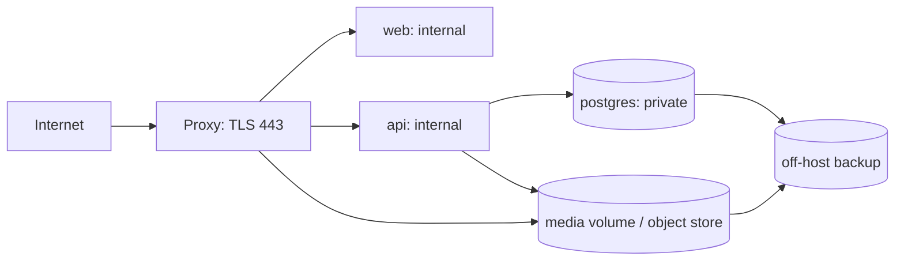

# 06 — Yêu cầu, triển khai và chất lượng

## 1. Traceability chức năng

FR01–FR13 giữ theo blueprint; UXxx là phần bổ sung từ UI/UX specification. “Done” trong bảng là tiêu chí tương lai, không phải kết quả đã đạt.

| ID | Module / màn hình | Acceptance để nghiệm thu |
|---|---|---|
| FR01 Register | auth / register | email unique, password hash, luôn role USER, invalid body 422 |
| FR02 Login | auth / login | credentials đúng tạo phiên; sai generic 401; logout revoke, không truy cập admin bằng USER |
| FR03 Profile | profiles / profile | retrieve/update atomic, styles/colors hợp taxonomy, min ≤ max |
| FR04 Browse | catalog / shop/detail | list/detail DB thật, ảnh, giá, variants, paging |
| FR05 Search | catalog / filters | kết hợp q/category/gender/color/style/occasion/price/available; sort ổn định |
| FR06 CRUD/import | catalog / admin | Admin CRUD/deactivate/import idempotent; ≥1.000 clean products có ảnh |
| FR07 Request | stylist / input | form luôn hoạt động; text có parse/default/confirmation minh bạch |
| FR08 Template | stylist | schema/slot/category đúng versioned rule; không bịa product |
| FR09 Top-K | recommendations | đúng eligibility, score/rank/reason; empty hợp lệ; tie deterministic |
| FR10 Save | outfits / Interactive Look | owner đúng, đủ slots, server tính total, giá/stock revalidate |
| FR11 History | outfits / My Looks | own list/detail/delete/favorite; user khác 404; duplicate có snapshot |
| FR12 Feedback | feedback | Like/Dislike upsert đúng target/context/version, không duplicate votes |
| FR13 Summary | admin | counters từ DB, phân biệt generated Looks và saved outfits |
| UX01 Three Looks | composer / result | ≥3 unique complete Looks khi có trong search pool; budget đúng; thiếu thì báo thật |
| UX02 Interactive | Look viewer | hotspot/item sync, drawer, reasons ≥3 facts có evidence |
| UX03 Replace | looks | alternatives cùng slot, preview delta, không vượt budget, revision mới |
| UX04 Variants | catalog/looks | size/variant thật, hết hàng disabled; không tự bịa dữ liệu |
| UX05 Rule/Taxonomy admin | admin | version/audit, validation trước publish/deactivate |
| UX06 Responsive/a11y | toàn frontend | desktop/tablet/mobile, keyboard/focus, AA, reduced motion |

## 2. Traceability phi chức năng

| ID | Mục tiêu từ blueprint | Cách đo / thiết kế |
|---|---|---|
| NFR01 Performance | CRUD/filter <2s, stylist/recommendation <5s trong demo | mục tiêu p95 server time, 2.000–5.000 products, 10 users đồng thời, machine spec ghi trong report; không gồm import/LLM ngoài |
| NFR02 Security | hash, JWT, RBAC, validate upload, không log secret | Argon2id, session revoke/rotate, CSRF/Origin, owner checks, limits, security tests |
| NFR03 Reliability | error schema, transaction | error code chuẩn, rollback multi-table, idempotency, no-result 200 |
| NFR04 Maintainability | module/service/repository, lint | dependency boundary, OpenAPI-generated types, formatter/linter, PR review |
| NFR05 Observability | structured logging, request context | request_id, path template, status,duration, version; không prompt/token/password |
| NFR06 Portability | Compose chạy máy nhóm/demo | image version khóa, healthcheck, migration/seed riêng, volumes, hướng dẫn đã kiểm chứng |
| NFR07 Extensibility | feedback/version, vector/try-on seam | ports, snapshots, media kind; Phase 2 additive migration |

Con số concurrency/p95 là cách đo đề xuất làm rõ yêu cầu gốc, chưa phải performance benchmark đã thực hiện. Không cam kết SLA thương mại hoặc khả năng chịu tải chưa đo.

## 3. Backlog theo phụ thuộc

| Epic | Việc triển khai | Phụ thuộc | Exit artifact |
|---|---|---|---|
| EP01 Requirements | chốt taxonomy, phạm vi, demo cases và quyền public | — | SRS/AC và decision log |
| EP02 Foundation | scaffold web/api, Compose, config, migrations, CI, error/logging | EP01 | clean build, health, test DB, generated client pipeline |
| EP03 Identity | register/login/session/CSRF, profile, route guards | EP02 | auth/profile qua API và UI, role/owner tests |
| EP04 Catalog | license/source check, cleaning, image store, import, admin CRUD, variants | EP01/02 | QA report ≥1.000 products, rerunnable import |
| EP05 Search | filters, pagination, sort, editorial grid/detail | EP03/04 | combined filters và price availability đúng |
| EP06 Stylist | intent normalization, 16 rule seed, plan schema/UI, processing | EP01/03 | deterministic template + confirmation cases |
| EP07 Recommendations | candidate query, scoring, beam composer, diagnostics, explanations | EP04/06 | three-Look flow khi feasible, budget tests |
| EP08 Look/Feedback | interactive viewer, replace, save/history/favorite/duplicate, reactions | EP03/07 | end-to-end persist và conflict handling |
| EP09 Release | admin counters/rules/taxonomy, a11y, security/perf/UAT, backup restore, demo | EP02–08 | release evidence và deployment/user guides |

Critical path: taxonomy + sạch catalog → candidate query → template/ranking/composer → save/feedback → demo. EP03 và EP04 có thể do nhóm triển khai song song sau foundation; điều này là kế hoạch dự án, không phải đã tạo ticket hoặc giao việc ra ngoài.

### 12 tuần / 6 sprint đề xuất

Chuẩn hóa thành sáu sprint hai tuần. Đây là điều chỉnh lịch cho dễ theo dõi; blueprint chia hai tuần thiết kế trước rồi có hai sprint cuối một tuần.

| Sprint | Tuần | Mục tiêu / demo |
|---|---|---|
| S1 | 1–2 | design baseline, taxonomy, scaffold, Compose/CI, migration identity/catalog |
| S2 | 3–4 | auth/profile end-to-end, catalog cleaning/import và admin product đầu tiên |
| S3 | 5–6 | ≥1.000 products sạch, filters/detail/variants, stylist plan và 16 rules |
| S4 | 7–8 | deterministic ranking + complete Looks, result screen, Interactive Look |
| S5 | 9–10 | replace/save/history/feedback, admin summary/rules/taxonomy, toàn luồng persist |
| S6 | 11–12 | regression, owner/security, performance/a11y, restore, docs, release/demo |

Mỗi sprint có PR review và test liên quan; không dồn integration đến S6. Motion nâng cao, demo cart và extended analytics chỉ sau core flow. Ba Look, reasons và replace được ưu tiên trước hiệu ứng trang trí.

## 4. Kiểm thử cần triển khai

| Mức | Công cụ dự kiến | Các case có giá trị |
|---|---|---|
| Unit | pytest | parser tiền, rule matching, score Decimal, deterministic ties, composer budget/min path |
| DB integration | pytest + PostgreSQL tách biệt | migration sạch, unique/composite FK/check, filters, rollback, idempotent import, refresh rotation |
| API integration | FastAPI test client | auth/CSRF/RBAC/owner, validation, no-result, stale prices, idempotency |
| Frontend component | Testing Library + Vitest | keyboard hotspot/drawer, budget form, error/retry, optimistic rollback |
| End-to-end | Playwright | register/login → profile → stylist → view/replace → save → reopen → feedback; admin counters |
| Security | API/E2E có kiểm soát | user A đọc/sửa data B, role injection, expired/revoked session, refresh reuse, upload invalid |
| Performance | load script có fixture cố định | filter và generate p50/p95, query count, seed quy mô demo, cold/warm phân biệt |
| UAT | acceptance checklist | 390/834/1440px, keyboard, no-hover, reduced motion, zero-result/stock conflict |

Không dùng SQLite thay PostgreSQL trong test integrity/query vì JSONB/index/constraint khác. Không chỉ kiểm tra status 200; assert eligibility, tổng, ownership, persistence. Performance test có môi trường/machine/dataset/algorithm version và report pass/fail thực tế.

CI tối thiểu: secret scan → backend lint/format + type checks phần đã typed → pytest unit/DB/API → frontend lint/typecheck/component → OpenAPI/type generation drift → production build → E2E critical flow. Build container trong release workflow. Migration dùng DB ephemeral, không credential production. Không phát minh coverage 100%; ưu tiên policy/transaction và regression có ý nghĩa.

## 5. Bảo mật và vận hành

- Config validate ở startup; production fail nếu thiếu secret hoặc bật demo defaults. Không commit .env, credentials, ảnh riêng, raw dumps. Chỉ log tên biến thiếu, không in giá trị.
- JWT issuer/audience/algorithm allowlist, expiry, active session check; refresh opaque ≥256-bit randomness, hash lưu DB. Có khóa ký riêng từng environment; rotation key có kế hoạch.
- Rate limit login/register/refresh và generate theo IP/user. Ban đầu proxy limit + giới hạn ứng dụng; nếu nhiều instance cần shared limiter, không giả định memory limit là global.
- Validate upload bằng decode và signature, không chỉ extension; ảnh JPEG/PNG/WebP ≤5 MB, giới hạn dimensions đề xuất 4096×4096, re-encode bỏ metadata, randomized object key. Không phục vụ SVG/HTML upload như ảnh trusted.
- ORM bind params; sort/filter/type allowlist. Không render user text bằng raw HTML. LLM output chỉ là dữ liệu parse.
- Chỉ proxy có public ingress. PostgreSQL không public port trên server production; object upload chỉ admin, tránh arbitrary remote URL. HTTPS bắt buộc khi phát hành.
- Structured logs: timestamp, request_id,user_id khi cần,path template,status,duration,error_code,algorithm_version; bỏ body auth, cookies, prompt thô. Metrics: request errors/p95, candidate/empty rate, budget violation, import counts.
- Admin audit append-only cho product/stock/price/rule/taxonomy changes; không log nguyên request chứa credentials. Summary dùng SQL aggregate với định nghĩa counter rõ.

## 6. Docker và môi trường

Local/demo: `proxy`, `web`, `api`, `postgres`; API dùng mounted media volume, proxy phục vụ `/media`. Production nhỏ: cùng mô hình single-host có HTTPS, persistent volumes và backup; managed PostgreSQL/S3-compatible là tùy chọn khi có ngân sách/hạ tầng. Chưa chọn nhà cung cấp hoặc báo chi phí chưa kiểm chứng.

Các biến cần trong `.env.example` khi scaffold: APP_ENV, APP_ORIGIN, DATABASE_URL, JWT signing configuration, ACCESS_TOKEN_TTL, REFRESH_TOKEN_TTL, STORAGE_BACKEND, MEDIA_ROOT hoặc S3 endpoint/bucket, LLM_ENABLED=false, optional LLM credentials, LOG_LEVEL. Giá trị nhạy cảm để trống; không đặt key vào NEXT_PUBLIC_*.

Trình tự bootstrap dự kiến: tạo env → build images → postgres healthy → chạy Alembic một lần bằng job/CLI → seed taxonomy/rules → import clean catalog → create admin qua CLI → start API/web/proxy → readiness + smoke test. Không để mọi worker tự migrate khi startup. Tài liệu lệnh cụ thể chỉ xuất bản sau khi có file Compose đã chạy kiểm chứng.

Release: backup DB/media → chạy migration additive → rollout images → readiness → smoke flow → theo dõi errors. Rollback app image khi schema tương thích; schema breaking cần restore/forward-fix plan riêng. Cấm tự chạy destructive downgrade vào production.

Backup đề xuất hằng ngày, trước mỗi migration; mục tiêu ban đầu RPO 24h/RTO 4h là mục tiêu vận hành cần test, chưa phải SLA. Ít nhất một restore drill vào môi trường sạch trước release. Ảnh và DB cùng manifest/version; secrets không nằm trong backup công khai.

## 7. Definition of Ready / Done

Ready cho feature: API/schema và owner policy rõ, acceptance case gồm lỗi, taxonomy/data cần có, UI states xác định. Done: implementation + migration nếu cần, tests có giá trị pass, lint/type/build pass, OpenAPI/client cập nhật, PR review, UI dùng DB thật, docs/runbook thay đổi tương ứng.

Release MVP chỉ đạt khi: clean Compose bootstrap thành công; ≥1.000 products sạch; auth/RBAC/owner pass; stylist/template/ranking/composer hợp ngân sách; Interactive Look/replace/save/history/feedback persist; admin counters đúng; responsive/a11y core; backup restore được; known issues và test report có dữ liệu thực.

Kịch bản demo: Female/Minimal/neutral/1.500.000 → “đi phỏng vấn” → template 4 slots → tối đa ba feasible Looks → giải thích → thay một món → Save → Like → mở My Looks → admin counters. Có deterministic local data; không cần LLM/network để hoàn tất.

## 8. Trạng thái bàn giao hiện tại

Đã có bộ thiết kế, chưa có executable services, migration, clean dataset hoặc CI thực thi. Các bảng kế hoạch/test ở trên không phải test report. Những đầu vào còn cần khi triển khai: dataset có quyền sử dụng, ảnh/giá có provenance, tên thương hiệu chính thức, môi trường deploy và secrets do chủ dự án quản lý. Có thể scaffold/auth/taxonomy bằng các giả định hiện tại trước khi có hosting.
